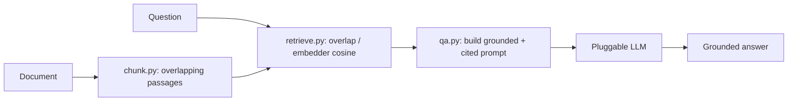

<p align="center">
  
</p>

<h1 align="center">Document QA</h1>

<p align="center">
  <strong>Document question-answering core — chunk documents, retrieve relevant passages, and build grounded, cited prompts — in Python.</strong><br>
  Plug in any LLM and embedder, or run it fully offline with the built-in deterministic fakes.
</p>

<p align="center">
  <em>Built and maintained by <a href="https://viprasol.com">Viprasol Tech</a> — AI Engineers. Full-Stack Builders.</em>
</p>

<p align="center">
  <a href="https://github.com/Viprasol-Tech/document-qa/actions/workflows/ci.yml"></a>
  <a href="LICENSE"></a>
  
  <a href="https://t.me/viprasol_help"></a>
  <a href="https://github.com/Viprasol-Tech/document-qa/stargazers"></a>
</p>

---

> **Provider-agnostic & offline-capable.** The library treats model access as two
> simple callables — an LLM `Callable[[str], str]` and an embedder
> `Callable[[str], list[float]]`. It ships deterministic **fake** providers so the
> demo and the full test suite run with **no network, no API keys, and no heavy
> SDKs**. Swap in OpenAI, a local model, or anything else without touching the core.
>
> *Not production-hardened — review and adapt before using with real workloads.*

---

## Features

- **Sentence-aware chunking** — split documents into overlapping, word-bounded passages; every word of the source is covered.
- **Two retrievers** — lightweight TF-style term overlap (no model needed) *or* genuine cosine similarity over a pluggable embedder.
- **Grounded prompts** — answers are built from numbered, cited `[passage N]` evidence so you can see exactly what supports them.
- **Pluggable providers** — bring your own LLM and embedder as plain callables; deterministic fakes included for offline use.
- **Typed & validated** — Pydantic models throughout, `mypy --strict` clean.
- **CLI** — `document-qa demo` answers a question over a built-in document offline.
- **Modern tooling** — ruff, mypy (strict), pytest, GitHub Actions CI.

## Quickstart

```bash
git clone https://github.com/Viprasol-Tech/document-qa.git
cd document-qa
python -m pip install -e ".[dev]"

# Answer a question over a built-in document, fully offline:
document-qa demo
document-qa demo --question "When did the Apollo program end?"
document-qa demo --use-embeddings
```

## Plug in a real provider

The core never imports a model SDK — you pass your own callables. Here is how you
would wire in a real LLM and embedder (pseudo-code for the model calls):

```python
from document_qa.qa import DocumentQA


def my_llm(prompt: str) -> str:
    # call your model of choice (OpenAI, local, etc.) and return the text
    return my_model.complete(prompt)


def my_embedder(text: str) -> list[float]:
    # return an embedding vector for the text
    return my_model.embed(text)


document = "... your document text ..."
qa = DocumentQA(
    document,
    llm=my_llm,
    embedder=my_embedder,
    use_embeddings=True,
    top_k=3,
)

result = qa.answer("What does the document say about X?")
print(result.answer)  # the grounded answer
print(result.prompt)  # the exact cited prompt that was sent
for scored in result.passages:
    print(scored.score, scored.chunk.text)
```

Omit `llm`/`embedder` to use the built-in deterministic fakes — everything runs offline.

## Architecture



## Roadmap

- [x] Sentence-aware overlapping chunking with full coverage
- [x] Term-overlap and embedding-cosine retrievers
- [x] Grounded, cited prompt builder + pluggable LLM/embedder
- [ ] Multi-document corpora and persisted vector indexes
- [ ] BM25 and hybrid (lexical + dense) retrieval
- [ ] Answer-with-citations post-processing and confidence scoring

## Contributing

PRs welcome — see [CONTRIBUTING.md](CONTRIBUTING.md) and our [Code of Conduct](CODE_OF_CONDUCT.md).

## Contact — Viprasol Tech Private Limited

- Website: [viprasol.com](https://viprasol.com)
- Email: [support@viprasol.com](mailto:support@viprasol.com)
- Telegram: [t.me/viprasol_help](https://t.me/viprasol_help) | WhatsApp: +91 96336 52112
- GitHub: [@Viprasol-Tech](https://github.com/Viprasol-Tech) | [LinkedIn](https://www.linkedin.com/in/viprasol/) | X [@viprasol](https://twitter.com/viprasol)

## License

[MIT](LICENSE) (c) 2025 Viprasol Tech Private Limited
